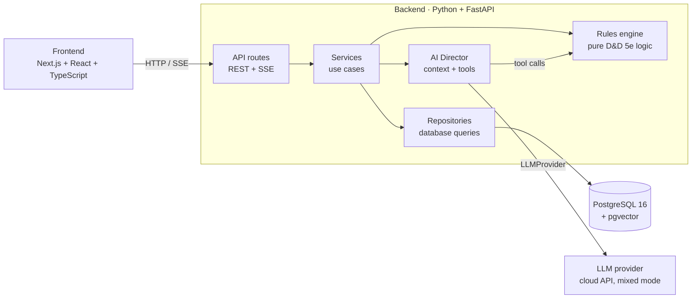
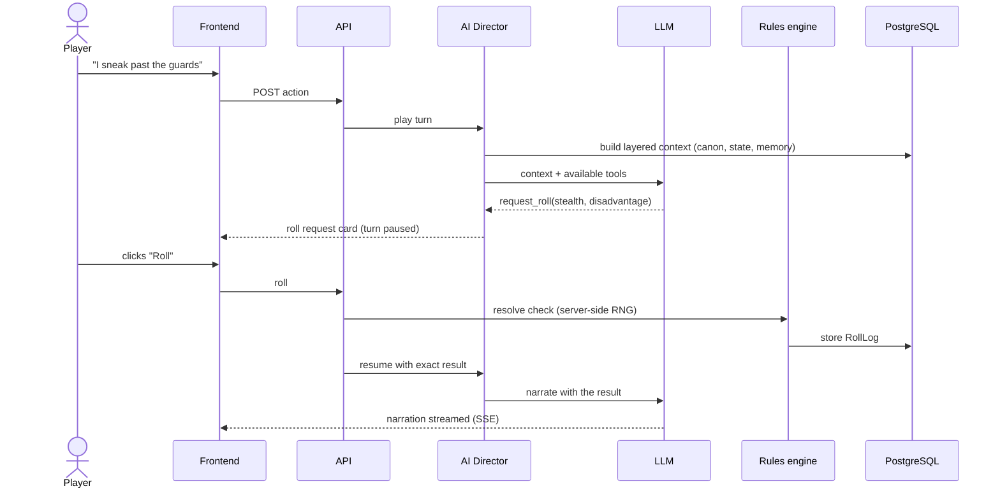

# LoreForge architecture

> **Status:** Phase 0 (foundations). Only the backend skeleton (`GET /health`,
> settings, database session, Alembic) is implemented. This document describes
> the target architecture; sections are marked as they are built.

LoreForge is a local web application to play solo Dungeons & Dragons campaigns
with an AI acting as Dungeon Master. Its central design idea is that **the AI
narrates, but deterministic code decides**: every number in the game comes from
a rules engine and is stored in PostgreSQL.

## Design principles

1. **The player rules.** If the player asks for something against the rules, the
   AI says which rule is broken and does it anyway. The engine applies the effect
   with `override=true` and records the exception.
2. **The engine decides the numbers.** Dice, damage, hit points, spell slots and
   conditions are computed in Python and stored in PostgreSQL. The LLM never
   invents a roll: it calls engine tools and narrates their exact results.
3. **The story persists.** When a campaign is created, the AI turns the player's
   premise into a structured, versioned *campaign bible*. Later deviations go
   through `propose_canon_change` and are recorded with their reason.
4. **The AI is a full Dungeon Master**: narration, non-player characters, world
   and encounters, always acting through tools.

## System overview

### Backend layers and dependency rule

| Layer | Folder | Responsibility |
| --- | --- | --- |
| API | `app/api/routes/` | Thin HTTP endpoints: validate input, call a service, return a schema |
| Schemas | `app/schemas/` | Pydantic request and response contracts |
| Services | `app/services/` | Use cases such as "create campaign" or "play a turn" |
| Repositories | `app/repositories/` | Database access |
| Rules | `app/rules/` | Pure D&D logic: dice, checks, combat, spells. No database, no HTTP |
| AI | `app/ai/` | `LLMProvider` implementations, tools, prompts, Director, memory |
| Core / DB | `app/core/`, `app/db/` | Settings, engine, sessions, ORM base |

Dependencies point one way: `api → services → repositories, rules, ai`. The
`rules` package depends on nothing, so it is fully unit-tested, and the AI layer
is tested with a fake provider.

## A turn of play (target, phase 3)

## Memory: keeping the AI from forgetting the story

The model has no memory of its own; it only knows what the backend sends each
turn. A `ContextBuilder` assembles a prioritised, token-budgeted context, and
eight mechanisms reinforce each other:

| # | Mechanism | Prevents |
| --- | --- | --- |
| 1 | Structured state in tables (NPCs, quests, items, locations) | Items vanishing, dead NPCs returning |
| 2 | Lorebook cards injected when their name appears | NPCs changing personality |
| 3 | Plot compass: current milestone and direction note each turn | The main plot fading away |
| 4 | Facts extracted at the end of each scene (subject · relation · object) | Forgotten promises, debts, secrets |
| 5 | Hierarchical summaries: scene → session → act → campaign | Losing the thread over many sessions |
| 6 | Hybrid retrieval: pgvector similarity + PostgreSQL full-text search | Old details that matter again |
| 7 | Memory tools: `recall(...)`, `note_fact(...)` | Invented answers when unsure |
| 8 | Coherence checker before showing the narration | Contradictions with stored state |

Every context sent to the model is stored as a `ContextSnapshot`, so a memory
failure can be traced to "not sent" (backend) or "sent and ignored" (prompt or
model). Memory quality is measured with scripted evaluations: planted facts and
later control questions, reported as a recall percentage.

## AI cost control

A `ModelRouter` sends the campaign bible and key scenes (milestones, boss fights,
session start and end) to a premium model, and routine narration plus internal
tasks (fact extraction, summaries, checks) to a cheaper one. Every call is stored
as an `LLMCall` with model, purpose, input, cached and output tokens, latency and
cost, shown on a usage screen against a monthly budget.

## Dice

Rolls are generated on the server (`secrets.SystemRandom`, seedable in tests) and
logged in `RollLog`. Campaigns choose a mode: interactive (the player presses
"Roll"), automatic, or physical dice (the player enters the result). The Director
asks for checks with `request_roll`, which pauses the turn.

## Tech stack

| Area | Choice |
| --- | --- |
| Frontend | Next.js (App Router, frontend only), React, TypeScript, Tailwind CSS, shadcn/ui, TanStack Query |
| Backend | Python 3.11, FastAPI, Pydantic v2, pydantic-settings |
| Data | PostgreSQL 16 + pgvector, SQLAlchemy 2.0 (async, psycopg 3), Alembic |
| AI | Cloud LLM APIs behind an `LLMProvider` interface, tool calling, SSE streaming |
| Rules content | D&D SRD 5.2.1 (CC-BY-4.0) |
| Quality | pytest, ruff, mypy (strict), Vitest, Playwright, ESLint, Prettier |
| Tooling | uv with a committed lockfile, Docker Compose, GitHub Actions |
| Deployment | Kubernetes + Helm (phase 7) |

## Architecture Decision Records

| ADR | Decision |
| --- | --- |
| [0001](adr/0001-async-database-access-with-psycopg3.md) | Async database access with SQLAlchemy and psycopg 3 |

Lessons learned along the way are in [engineering notes](engineering-notes.md).

## Roadmap

| Phase | Scope | Status |
| --- | --- | --- |
| 0 | Foundations: repository setup, backend skeleton, frontend skeleton, Docker Compose, CI, README | In progress |
| 1 | Full stack skeleton: home screen, campaigns and characters API | |
| 2 | Characters and rules engine: SRD data, character sheet, checks, dice tray | |
| 3 | AI Director: campaign bible, game table, tool calling, streaming, model routing, usage screen | |
| 4 | Memory: facts, summaries, hybrid retrieval, coherence checker, memory evaluations | |
| 5 | Full rules: combat, conditions, spells, inventory, rests | |
| 6 | Images, combat map, 3D dice | |
| 7 | Deployment: Helm chart on Kubernetes, optional cloud demo | |
